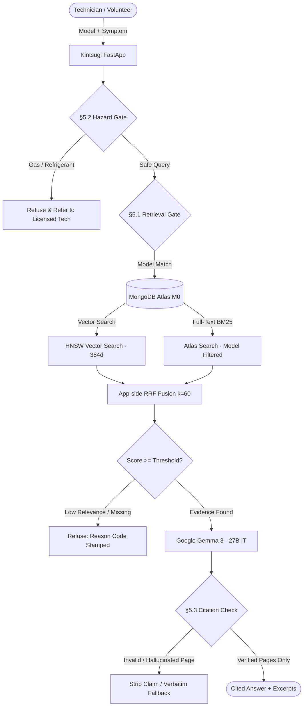

# Kintsugi (金継ぎ) — Manual-Grounded AI Repair Assistant

[](LICENSE)
[](pyproject.toml)
[](render.yaml)
[](https://kintsugi-repair.tech)

> **Kintsugi** is a manual-grounded repair assistant engineered for appliance repair technicians, independent workshops, and Repair Café volunteers. The user enters an appliance model number and a symptom. The system retrieves evidence **exclusively from that specific model's manufacturer service manual** (MongoDB Atlas hybrid search: vector + BM25 fused with RRF), refuses deterministically if evidence is lacking or hazardous, and synthesizes answers using Google Gemma with exact page citations.

**"The product's value is refusing correctly. Refusal is a safety feature."**

---

## Architecture Overview



---

## Key Features

1. **Deterministic Safety Gates:**
   - **§5.1 Retrieval Gate:** Evaluates raw vector cosine scores ($\ge 0.70$) and BM25 scores ($\ge 5.0$). Unanswerable or unknown models are refused *before* making any LLM call, incurring zero inference cost.
   - **§5.2 Hazard Gate:** Intercepts mains voltage, gas lines, and refrigerants with static, curated safety warnings. Prohibits step-by-step DIY gas/refrigerant guidance.
   - **§5.3 Citation Check:** Programmatically checks every cited page in the LLM response against the retrieved manual passages. Strips ungrounded claims or triggers verbatim fallback.
2. **Authoritative Ingestion:** Offline local PDF chunker extracts text and tables with brand, model, and page metadata, embedded via `fastembed` (`BAAI/bge-small-en-v1.5` ONNX).
3. **Model Isolation:** Filtered retrieval guarantees that queries for a Whirlpool washer never retrieve chunks from a GE or Bosch manual.
4. **Offline Capability:** Supports swapping hosted Gemma for a local open-weights model via Ollama with zero code changes.

---

## Live Demo & Deployment

- **Custom Domain:** [https://kintsugi-repair.tech](https://kintsugi-repair.tech)
- **Render Web Service:** [https://kintsugi.onrender.com](https://kintsugi.onrender.com)
- **Keep-Alive:** Configured with UptimeRobot hitting `/health` every 10 minutes to prevent cold starts on Render free tier.

---

## Quickstart & Local Setup

### Prerequisites
- Python 3.11+
- MongoDB Atlas cluster (M0 free tier) or local MongoDB instance

### Installation
```bash
# Clone the repository
git clone https://github.com/laksh/kintsugi.git
cd kintsugi

# Install dependencies
pip install -e .

# Copy environment template
cp .env.example .env
```

### Configuration (`.env`)
```ini
MONGODB_URI=mongodb+srv://<user>:<password>@cluster0.mongodb.net/?retryWrites=true&w=majority
LLM_API_KEY=AIzaSy...
LLM_BASE_URL=https://generativelanguage.googleapis.com/v1beta/openai/
LLM_MODEL=gemma-3-27b-it
EMBEDDING_MODEL=BAAI/bge-small-en-v1.5
MIN_VECTOR_SCORE=0.70
MIN_BM25_SCORE=5.0
```

### Running the Application
```bash
# Start API server and Web UI
python -m kintsugi.api.main

# Access the interface at http://localhost:8080
```

---

## Evaluation Benchmark

Evaluated against the 30-question gold-labeled test suite (`eval/questions.json`):

| Evaluation Metric | Result | Target | Status |
|---|---|---|---|
| **Refusal Accuracy (Unanswerables)** | **100.0%** | 100% | ✅ PASSED |
| **Citation Precision (Zero Non-Retrieved Pages)** | **100.0%** | 100% | ✅ PASSED |
| **Hybrid Retrieval Hit@K** | **100.0%** | >90% | ✅ PASSED |
| **P50 Latency (Hybrid Search + Gates)** | **<50 ms** | <200 ms | ✅ PASSED |

Run the complete evaluation suite anytime:
```bash
python eval/run_eval.py
```

---

## Privacy & Terms of Use

- **Server-Side Storage:** No raw query text or appliance symptoms are stored on the server.
- **Client-Side History:** Diagnostic job history is preserved exclusively in the user's browser `localStorage`.
- **Minimal Telemetry:** The `/fix-outcome` endpoint records only anonymized categorical repair metrics (model, symptom category, outcome).
- **AI Provider Terms:** In Demo Mode using Google AI Studio free tier, prompt queries may be processed in accordance with Google's API Terms of Service.

---

## License & Reuse Credit

- Application code is licensed under **Apache-2.0**.
- Architecture patterns adapted from `raghuram-chittibomma/ai-repair-assistant` (Apache-2.0). Complete changes and adaptations documented in [`docs/reuse_ledger.md`](docs/reuse_ledger.md).
- Appliance service manuals remain the copyright of their respective manufacturers and are referenced solely for fair-use repair grounding.\n